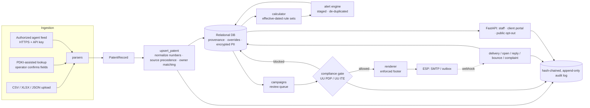

# Architecture

## Layers

| Layer | Responsibility | Depends on |
|---|---|---|
| `domain` | Pure functions and value objects: numbers, dates, rules, calculator, matching, alerts, i18n | standard library only |
| `compliance`, `security`, `notifications`, `ingestion` | Policy and integration logic (send gate, click-wrap, hashing, crypto, templates, parsers, sources) | `domain` |
| `db` | SQLAlchemy models, append-only triggers | — |
| `services` | Use cases with transactions and audit: upsert, recompute, campaigns, agreements, auth, reports | all of the above |
| `api` | HTTP: authentication, RBAC, agreement gating, CSRF, serialization | `services` |

The domain layer has no I/O, so every legal calculation is unit-testable with fixed dates, and the same code serves the API, the daily job and e-mail rendering.

## Key decisions

**Rules are data, selected by date.** The regime is changing (Law 65/2024's Working Statement awaits implementing regulations), so term, annuity, grace and Working Statement parameters are JSON rule sets with effective dates, citations and a verification status. A regulation change is a reviewed data change, not a code change, and historical installments keep the rules that applied when they fell due.

**Verification over automation.** There is no public machine-readable DGIP API, so the system does not scrape PDKI. It supports operator-assisted PDKI capture, verified uploads and authorized feeds, ranks sources (manual verification > agent feed > PDKI/SAKI > user input > supplementary), stops lower-ranked sources overwriting verified fields, and makes uncertainty visible: confidence score and band, data age, `UNKNOWN` payment status instead of guessing, and `LAPSE_SUSPECTED` instead of asserting a lapse.

**Compliance is enforced at the last responsible moment.** The gate runs immediately before each message is handed to the ESP, using the live suppression list and consent ledger, so an opt-out recorded seconds earlier is honoured. Blocked messages are stored with machine-readable reasons. Template authors cannot omit the legal footer because the renderer appends it.

**Personal data minimization.** Contact names, e-mails and phones are AES-256-GCM encrypted with the column bound as associated data. Look-ups and the suppression list use a keyed HMAC blind index, so an erased person can be kept off future sends without retaining their address. Viewers see masked e-mails, and every PII read by privileged roles is audited.

**Tamper evidence.** `audit_log`, `agreement_acceptance` and `consent_event` reject UPDATE and DELETE at the database level (SQLite triggers; PostgreSQL trigger function included), and the audit log and acceptance records are SHA-256 hash chains that `GET /audit/verify` and `idpatent verify-audit` check end to end.

**Multi-tenancy.** Every business row carries `firm_id`; every query filters by the caller's firm. Cross-firm access returns 404. Client-portal users are further limited to an explicit list of owners.

## Alert lifecycle

For each target date the engine finds the most urgent lead-time stage already reached (for example `90d`, then `60d`). The `(kind, reference, stage)` triple is the de-duplication key, so the daily job creates an alert only on entering a new stage. When a stage moves on or the obligation is satisfied (payment recorded, statement filed), open time-based alerts are marked `RESOLVED` automatically. Event alerts (status or ownership change) stay open until acknowledged.

## Data model (core)

`Firm` 1─* `User`, `Owner`, `Patent`, `Contact`, `Campaign`, `Alert`, `LegitimateInterestAssessment`
`Patent` 1─* `AnnuityPayment`, `WorkingStatementFiling`, `Alert`; `Patent` *─1 `Owner`
`Contact` *─1 `Owner`; `Contact` 1─* `ConsentEvent` (append-only), `Communication` 1─* `CommunicationEvent`
`AgreementDocument` 1─* `AgreementAcceptance` (append-only, hash-chained); `AuditLog` (append-only, hash-chained)

Computed fields on `Patent` (`protection_end`, `next_annuity_due`, `next_grace_end`, `next_ws_due`, `computed_status`, `confidence`) are a cache for listing and reporting. Detail views always recompute from facts.

## Extension points

* `ingestion.sources.PatentDataSource`: add a source (for example a future official DGIP API) by implementing `lookup()`.
* `security.crypto.KeyProvider`: back field encryption with a KMS/HSM.
* `notifications.esp.EmailProvider`: plug in an ESP's HTTP API instead of SMTP.
* Rule sets: add `id_*.json` files; nothing else changes.
